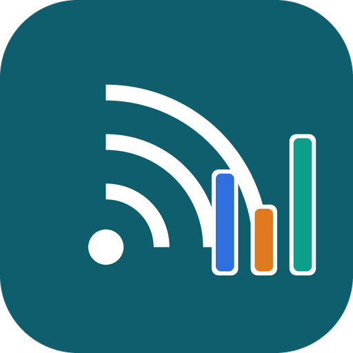

<h1 align="center">EMF Exposure Vector</h1>

Frequency-aware electromagnetic exposure dosimetry for the 5G/6G era — on your Android phone. 
<b><a href="../../releases/latest">⬇ Download the latest APK</a></b>

---

## English

EMF Exposure Vector reads your phone's own radios (cellular 2G/3G/4G/5G, Wi-Fi, Bluetooth LE, magnetometer), estimates your phone's own transmit power and SAR, and compares everything with the **ICNIRP** international exposure limits.

It implements the framework of the technical report *"Human Electromagnetic Exposure in the 5G/6G Era: A Multi-Source Dosimetric Framework Integrating RF, mmWave, ELF, Occupational Exposure, and Specific Absorption Rate"* by **Mustafa Sadiq Latief (Mustafa S. Aljumaily)**.

### Features
- **Total Exposure Index:** one headline percentage of the strictest applicable limit, time-averaged (6 min for SAR, 30 min for whole-body RF), with a 95 % range and confidence level.
- **Live tab:** measured downlink exposure per cell, Wi-Fi access point and Bluetooth device; estimated uplink power and SAR per technology; CSV export.
- **Calculator:** far-field power density, E/H fields, compliance distances, near-field checks.
- **Vector:** multi-source exposure scenarios, without adding different physical quantities together.
- **Cases:** interactive versions of the report's worked case studies (5G macro site, 900 MHz mast, smartphone SAR, mmWave/radar, 400 kV power line).
- **Uncertainty:** Monte Carlo simulation with Sobol sensitivity indices.

### Install
1. Download `EMF-Exposure-Vector-v1.2.apk` from [Releases](../../releases/latest).
2. Allow **Install unknown apps** for your browser or file manager when Android asks.
3. If **Google Play Protect** warns that the app is unknown, choose **More details › Install anyway**. The app is new and not yet on Google Play.
4. Open the app, grant the permissions, and turn on **Location** (Android requires it to read cell and Wi-Fi measurements).
5. Enter your phone's **declared 10 g SAR** (head and body) at the bottom of the Live tab. Find it at samsung.com/sar or your phone's manual (use EU values).

Requires Android 6.0 or newer.

### Privacy
All processing happens on the phone. The app has no internet permission, sends nothing anywhere, and stores no location. CSV export happens only when you choose to save a file.

### Accuracy
Android does not expose calibrated field strength or the phone's real transmit power. Downlink values are screening estimates (±10 dB typical, 95 %). Uplink and SAR are model estimates scaled from your phone's declared SAR. A certified SAR lab achieves about ±1.2 dB. Use the app for awareness and comparison; confirm anything near 100 % with calibrated equipment.

**This is an educational and engineering screening tool, not a certified measuring instrument or a medical device.**

### Verify your download
Compare the SHA-256 checksum shown in the release notes with your file:
- Windows: `certutil -hashfile EMF-Exposure-Vector-v1.2.apk SHA256`
- macOS/Linux: `shasum -a 256 EMF-Exposure-Vector-v1.2.apk`

### Build from source
- **Android Studio:** File › Open this folder, let Gradle sync, then Build › Generate Signed App Bundle or APK with your own keystore.
- **Command line (Ubuntu, no Gradle):** install `android-sdk-platform-23 aapt apksigner zipalign dalvik-exchange default-jdk`, set `EMF_KEYSTORE`, `EMF_STORE_PASSWORD`, `EMF_KEY_PASSWORD`, then run `./build.sh`.

---

## العربية

تطبيق **EMF Exposure Vector** يقرأ إشارات هاتفك الحقيقية: شبكة الجوال (2G و3G و4G و5G)، والواي فاي، والبلوتوث، والحقل المغناطيسي. يقدّر أيضاً قدرة البث الصادرة من هاتفك نفسه ومعدل امتصاص جسمك لها (SAR)، ثم يقارن كل ذلك بالحدود الدولية للجنة **ICNIRP**.

التطبيق تطبيق عملي لإطار التقرير العلمي *«التعرّض البشري للمجالات الكهرومغناطيسية في عصر الجيل الخامس والسادس»* للباحث **مصطفى صادق لطيف (مصطفى صادق الجميلي)**.

### التثبيت
1. حمّل الملف `EMF-Exposure-Vector-v1.2.apk` من صفحة [الإصدارات](../../releases/latest).
2. عندما يطلب أندرويد ذلك، اسمح بـ**تثبيت التطبيقات غير المعروفة** للمتصفح أو مدير الملفات.
3. إذا ظهر تحذير **Google Play Protect**، اختر **مزيد من التفاصيل ← التثبيت على أي حال**. سبب التحذير أن التطبيق جديد وغير منشور على المتجر بعد.
4. افتح التطبيق ووافق على الأذونات، وفعّل **خدمة الموقع**. أندرويد يشترطها لقراءة إشارات الشبكة والواي فاي.
5. أدخل قيمة **SAR المعلنة لهاتفك** (الرأس والجسم، 10 غرام) أسفل صفحة Live. تجدها في موقع samsung.com/sar أو دليل الهاتف، واختر القيم الأوروبية.

يعمل على أندرويد 6.0 فما فوق.

### فهم الرقم الكبير
- **أقل من 20%:** أخضر، تعرّض منخفض.
- **من 20% إلى 100%:** أصفر، ضمن الحد.
- **100% فأكثر:** أحمر، يستحق التحقق بجهاز قياس معايَر.

الحد الدولي ليس نقطة بدء الضرر، فهو موضوع بهامش أمان كبير. اضغط على الزر الكبير لترى التفاصيل ودقة القياس.

### الخصوصية
كل الحسابات تتم داخل الهاتف. التطبيق لا يملك إذن الاتصال بالإنترنت، ولا يرسل أي بيانات، ولا يحفظ موقعك.

### الدقة
الهاتف ليس جهاز قياس مختبرياً، لذلك النتائج تقديرية بمدى خطأ يقارب ±10 ديسيبل، بينما مختبرات SAR المعتمدة تصل إلى ±1.2 ديسيبل تقريباً. التطبيق مناسب للتوعية والمقارنة بين الأماكن والعادات. أي قراءة قريبة من 100% تُؤكَّد بجهاز معايَر.

**التطبيق أداة توعوية وهندسية تقديرية، وليس جهاز قياس رسمياً أو أداة طبية.**

---

© 2026 Mustafa Sadiq Latief (Mustafa S. Aljumaily) · Contact: mustafasadiq0@gmail.com
